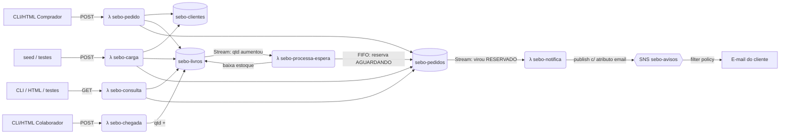
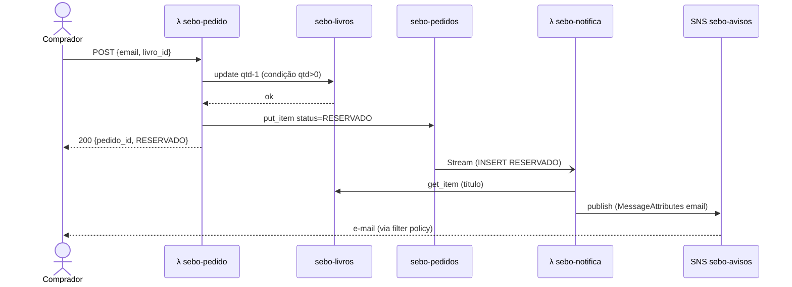
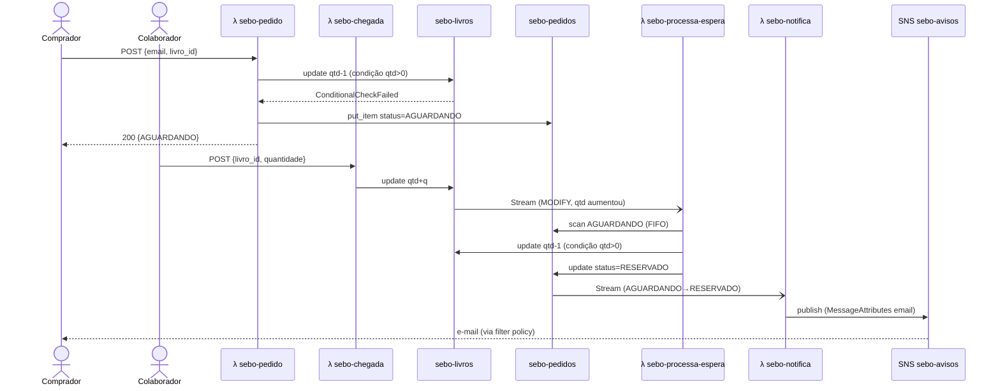

# Relatório — Trabalho 2: Livraria "Sebo" na AWS

## 1. Identificação

- **Disciplina:** Distribuição e Concorrência (2026/2)
- **Integrantes:** Thiago Coqueiro, Guilherme Gratz, Felipe Peixoto
- **Conta AWS Academy com a implementação:** thiagodamicoc@gmail.com

## 2. Visão geral e decisões de projeto

O comprador informa o livro desejado. Havendo estoque, o livro é **reservado** e o cliente recebe e-mail para efetivar a compra na livraria. Não havendo, o pedido fica `AGUARDANDO` e o cliente é avisado por e-mail quando o livro chega. Estoque, clientes e pedidos ficam no DynamoDB.

| Tema | Decisão | Justificativa |
|---|---|---|
| Linguagem | Python 3.12 | Padrão das aulas |
| Nuvem | Learner Lab, `us-east-1`, `LabRole` | Restrição do ambiente |
| Banco | DynamoDB + Streams (`NEW_AND_OLD_IMAGES`) | Mesmo padrão do lab Inventory / Check-Stock |
| E-mail | SNS, tópico único `sebo-avisos`, filter policy `{"email": [...]}` por inscrição | Um tópico atende todos os clientes; cada um só recebe o seu |
| HTTP | Lambda Function URL, Auth NONE, CORS | Padrão dos slides |
| Pedido disponível | Reserva: baixa estoque e pedido `RESERVADO` | Evita vender o mesmo exemplar duas vezes |
| Fila de espera | FIFO por `criado_em` | Justiça com os clientes mais antigos |
| Clientes | Tabela `sebo-clientes` pré-carregada; e-mail desconhecido é recusado | Conforme enunciado (cliente já inscrito) |
| UI colaborador | Mínima: chegada de livros e listar estoque | Cenários cobertos por scripts |
| Interfaces | CLI Python + página HTML+JS | Estilo do frontend do somador e do `start.sh` |
| Testes | Cenários Python contra as Function URLs reais + `testes.sh` | Prova o comportamento ponta a ponta |
| Infraestrutura | Console, com roteiro no README | Como nos slides |

Ligações com as aulas:
- **Lambda de responsabilidade única** (como no lab Inventory): cada uma das 6 funções faz uma coisa.
- **Streams como gatilho** (como `Check-Stock`): o e-mail só sai da `sebo-notifica`, disparada pela mudança de status do pedido.
- **Condição de corrida** (aula de threads): o último exemplar disputado por duas requisições é resolvido por escrita condicional atômica (`ConditionExpression quantidade > 0`), sem lock explícito.

## 3. Diagrama de blocos

## 4. Diagramas UML de sequência

### (a) Compra com livro disponível

### (b) Compra indisponível → chegada → notificação

## 5. Modelo de dados

| Tabela | Partition key | Atributos | Stream |
|---|---|---|---|
| `sebo-livros` | `livro_id` (S) | `titulo`, `autor`, `preco` (N), `quantidade` (N) | Sim |
| `sebo-clientes` | `email` (S) | `nome` | Não |
| `sebo-pedidos` | `pedido_id` (S, uuid4) | `email`, `livro_id`, `status` (`AGUARDANDO`/`RESERVADO`), `criado_em`, `reservado_em` | Sim |

Todas em capacidade On-demand.

## 6. Descrição das Lambdas

| Lambda | Gatilho | Responsabilidade |
|---|---|---|
| `sebo-pedido` | Function URL POST | Valida entrada (400), cliente e livro (404); reserva com `update_item` condicional; grava pedido `RESERVADO` ou `AGUARDANDO`. Não envia e-mail |
| `sebo-chegada` | Function URL POST | Soma a quantidade recebida ao estoque (404 se livro inexistente, 400 se qtd ≤ 0) |
| `sebo-processa-espera` | Stream `sebo-livros` | Quando o estoque aumenta, atende pedidos `AGUARDANDO` em FIFO enquanto houver estoque |
| `sebo-notifica` | Stream `sebo-pedidos` | Quando um pedido vira `RESERVADO`, publica no SNS com o atributo `email` |
| `sebo-consulta` | Function URL GET | Lista livros, pedidos de um e-mail ou um pedido |
| `sebo-carga` | Function URL POST | `reset` (apaga pedidos) e `seed` (recarrega livros e clientes); usada por seed e testes |

## 7. Instalação e operação

Roteiro completo de console, operação (CLI e web), `curl` e troubleshooting no [README.md](README.md).

## 8. Testes realizados

Executados com `./testes.sh` contra as Function URLs reais. Resultados a preencher após a execução no Learner Lab.

| # | Cenário | Esperado | Resultado |
|---|---|---|---|
| 1 | `compra_disponivel` | Pedido `RESERVADO`, qtd 2→1, e-mail ao cliente A | `<preencher>` |
| 2 | `compra_indisponivel` | Pedido `AGUARDANDO`, sem e-mail | `<preencher>` |
| 3 | `compra_indisponivel_depois_chega` | Chegada +1 → `RESERVADO`, qtd 0, e-mail ao A | `<preencher>` |
| 4 | `fila_fifo` | A reservado primeiro, B depois; dois e-mails em ordem | `<preencher>` |
| 5 | `chegada_maior_que_fila` | 1 esperando, chegam 3 → 1 reservado, qtd final 2 | `<preencher>` |
| 6 | `ultimo_exemplar_concorrente` | 2 threads, qtd 1 → 1 `RESERVADO` e 1 `AGUARDANDO`, qtd 0 | `<preencher>` |
| 7 | `cliente_nao_cadastrado` | 404, nenhum pedido criado | `<preencher>` |
| 8 | `livro_inexistente` | 404 | `<preencher>` |
| 9 | `entrada_invalida` | 400 | `<preencher>` |

## 9. O que funcionou / o que não funcionou

| Item | Funcionou? | Observações |
|---|---|---|
| Criação das tabelas e Streams | `<preencher>` | |
| Inscrições SNS com filter policy | `<preencher>` | Verificar que o cliente B não recebe o e-mail do A |
| Lambdas e eventos de teste no console | `<preencher>` | |
| Function URLs / CORS | `<preencher>` | |
| Cenários automatizados | `<preencher>` | |
| CLI comprador / colaborador | `<preencher>` | |
| Página web | `<preencher>` | |

Validação local feita até aqui (sem AWS): compilação de todos os `.py` (`py_compile`) e `bash -n` nos scripts.

## 10. Limitações

- A **subscription filter policy** do SNS não foi vista nos slides; foi escolhida para usar um tópico único com entrega seletiva.
- **Function URLs públicas** (Auth NONE); `sebo-carga` apaga dados e fica exposta. Desativar as URLs após a apresentação.
- Uso de **`scan`** com filtro em vez de índice (GSI não foi visto; volume pequeno).
- Credenciais e sessão do Learner Lab são temporárias.
- Em `sebo-processa-espera`, se o pedido já tiver sido tratado por outra execução, o exemplar baixado é devolvido ao estoque (compensação adicionada para não perder estoque em reentrega do Stream).
